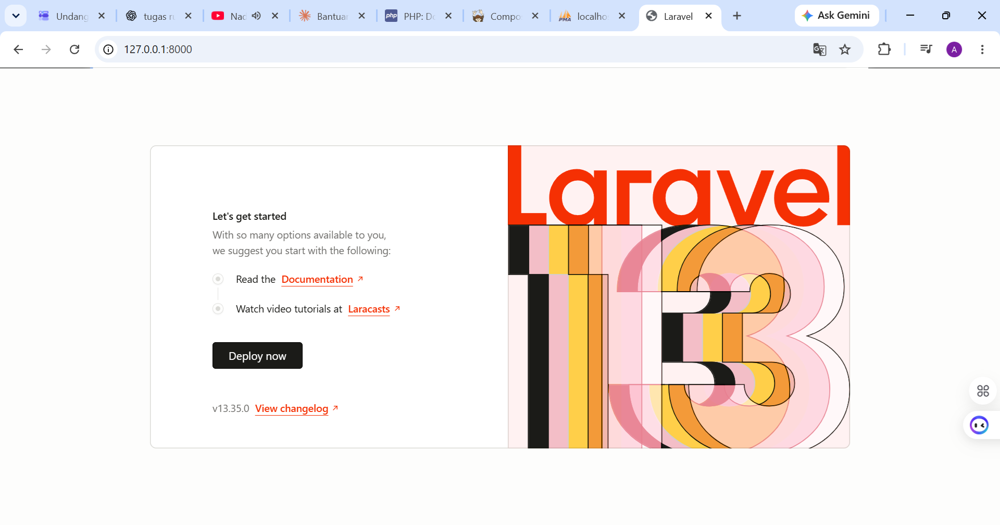
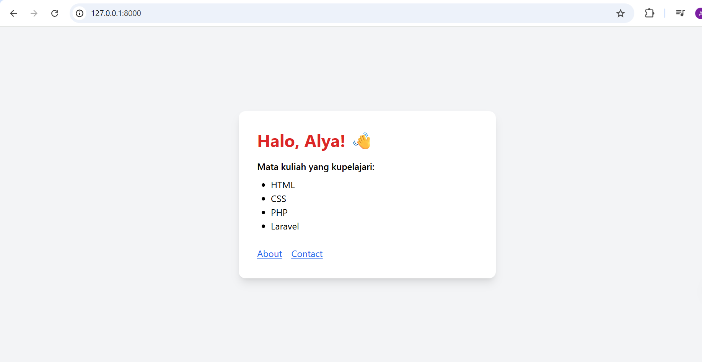
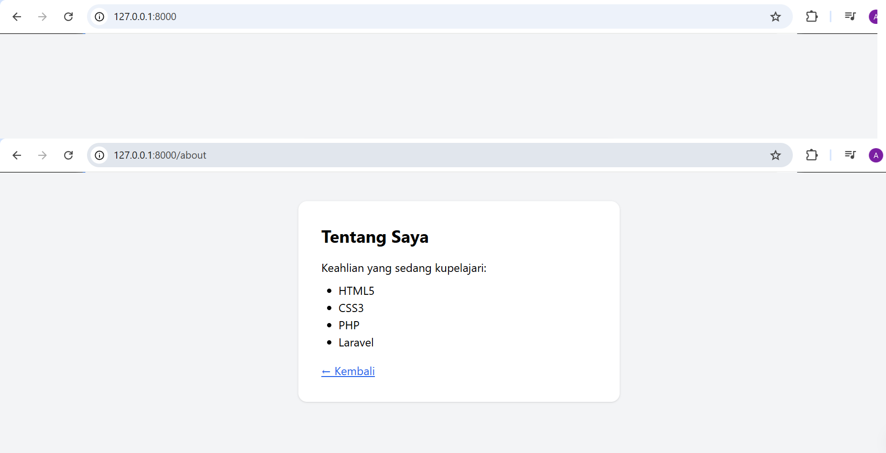
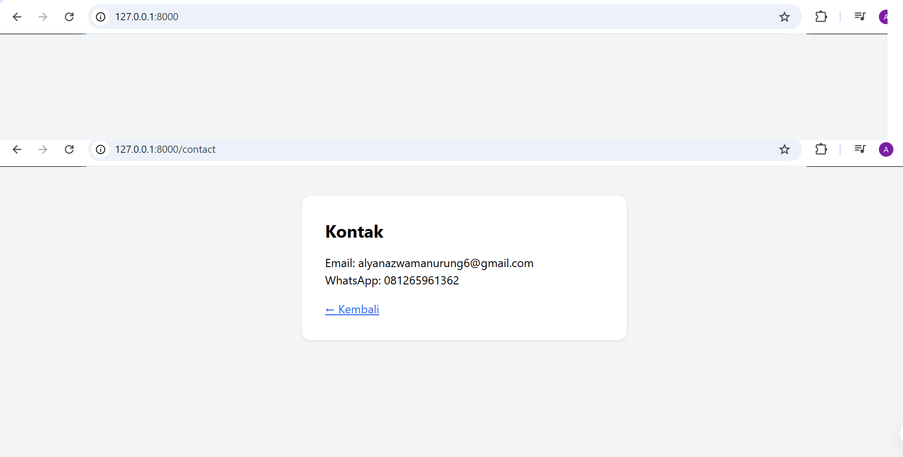
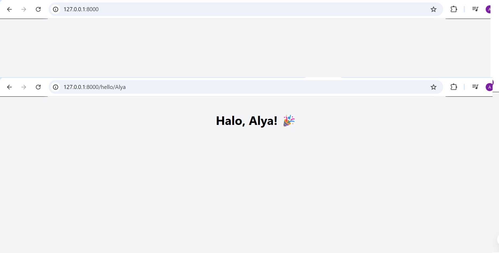

# TugasWeb-P9-LaravelSetup

Tugas Rutin 9 - Pemrograman Web: Setup Laravel

## Langkah Install

1. Pastikan PHP >= 8.2, Composer, dan MySQL (XAMPP) sudah terpasang
2. Clone repo ini:
```bash
   git clone https://github.com/alyanazwa1234.github.io/TugasWeb-P9-LaravelSetup.git
   cd TugasWeb-P9-LaravelSetup
```
3. Install dependency:
```bash
   composer install
```
4. Salin file environment dan generate key:
```bash
   copy .env.example .env
   php artisan key:generate
```
5. Buat database `tugasweb_p9` di phpMyAdmin, lalu atur `.env`:
```
   DB_CONNECTION=mysql
   DB_HOST=127.0.0.1
   DB_PORT=3306
   DB_DATABASE=tugasweb_p9
   DB_USERNAME=root
   DB_PASSWORD=
```
6. Jalankan migration:
```bash
   php artisan migrate
```
7. Jalankan server:
```bash
   php artisan serve
```
   Buka http://127.0.0.1:8000

## Route

| URL | Keterangan |
|-----|-----------|
| `/` | Halaman utama (data dinamis dari array di route) |
| `/about` | Halaman about (lewat PageController) |
| `/contact` | Halaman kontak (lewat PageController) |
| `/hello/{nama}` | Bonus: route parameter |

## Struktur Folder

| Folder/File | Fungsi |
|-------------|--------|
| `app/Models/` | Model Eloquent (M pada MVC), contoh `Course.php` |
| `app/Http/Controllers/` | Controller (C pada MVC), contoh `PageController.php` |
| `resources/views/` | Tampilan Blade (V pada MVC) |
| `routes/web.php` | Peta URL ke controller/view |
| `database/migrations/` | Versi skema database |
| `config/` | File konfigurasi aplikasi |
| `public/` | Document root, satu-satunya folder yang diakses browser langsung |
| `storage/` | Cache, log, dan file upload |
| `vendor/` | Dependency dari Composer |
| `.env` | Konfigurasi lokal (tidak di-commit) |

## Screenshot

### Welcome Page Laravel


### Home


### About


### Contact


### Bonus: Route Parameter
